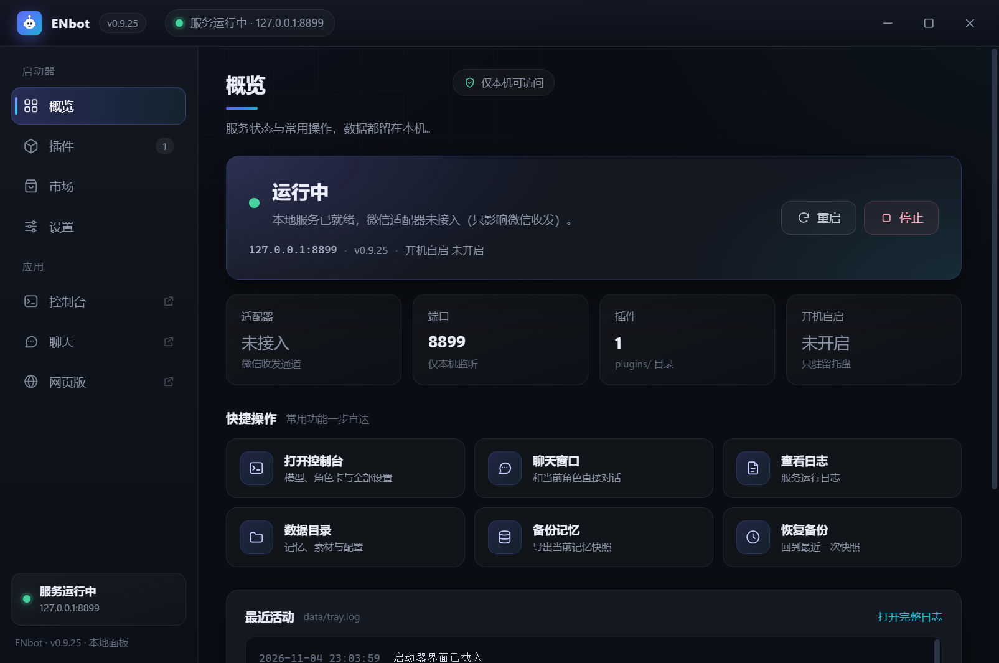

# E Night Companion（ENbot）桌面版

E Night Companion 简称 **ENbot**。E 可以是 **Eternal（永恒）**，也可以是 **Electronic（电子）**。

ENbot 现在像正常软件一样用：**双击桌面图标启动，右下角托盘常驻，没有黑窗口**。

---

## 双击之后看到什么

双击图标会打开**启动器**（不需要浏览器）：



- 无边框窗口，左侧导航：概览 / 插件 / 市场 / 设置
- 右侧是「应用」入口：控制台 / 聊天 / 网页版
- 界面按系统 DPI 比例渲染：150% / 200% 缩放下也是原生物理像素，不会被 Windows 位图放大

**概览**是启动器的主页：

| 区域 | 内容 |
|---|---|
| 状态卡 | 服务是否运行、适配器是否接入、端口与版本 |
| 指标 | 适配器 / 端口 / 插件数 / 开机自启 |
| 快捷操作 | 打开控制台、聊天、查看日志、数据目录、备份/恢复记忆 |
| 最近活动 | `data/tray.log` 的最后几条，自动刷新 |

**控制台 / 聊天**点开后是**独立的原生窗口**（同样用 WebView2 内嵌，不需要 Edge）。
启动器窗口保持不动，关掉控制台窗口只是隐藏，下次秒开。

关掉启动器窗口 = 缩到托盘，服务继续跑。

## 怎么用

```
桌面「ENbot」图标  ← 双击启动（和普通软件一样）
右下角托盘图标        ← 右键菜单
```

托盘右键菜单：

| 菜单项 | 作用 |
|---|---|
| ENbot v0.9.24 · 端口 8899 | 只显示，点了没反应（第一行） |
| 打开启动器 | 把启动器窗口调出来（概览页） |
| 打开控制台 | 独立窗口打开控制台 |
| 聊天窗口 | 独立窗口打开聊天页 |
| 备份记忆 | 导出记忆快照到 `data/backups/`，结果弹窗 |
| 恢复最近备份… | 从最近快照恢复（会二次确认，恢复前自动再存一份） |
| 查看日志 | 用记事本打开 `data/app.out.log` |
| 重启服务 | 停掉核心再拉起（改完配置不想重启电脑时用） |
| 打开数据目录 | 打开 `data/`（记忆、素材都在里面） |
| 开机自启 | 勾选后开机自动启动（写 HKCU Run，不需要管理员） |
| 退出（停止服务） | 会二次确认，退出后聊天中断 |

双击托盘图标 = 打开控制台。

> 开机自启是**静默启动**：只驻留托盘、不弹窗。第一次点「打开启动器」时才创建窗口，
> 之后关掉只是缩到托盘，再打开不会重建。

> 以前散落在根目录的 `.bat`（备份记忆 / 恢复记忆 / 状态面板 / 桌面聊天 / 工具菜单…）
> 功能都已进托盘菜单和启动器，**不用再双击 bat**。bat 保留着，给习惯命令行的人用。

### 图标颜色就是状态

| 颜色 | 含义 |
|---|---|
| 绿 | 服务运行中 |
| 灰 | 服务已停止 |
| 黄 | 正在重启 |

鼠标悬停能看到版本、端口和当前状态。

### 服务挂了会自动拉起

服务意外退出时托盘会自动重启它，**最多 3 次**（两次之间至少隔 15 秒，避免死循环），
重启时会弹气泡提示。连续失败 3 次后不再自动重试，避免无意义刷屏——这时点「重启服务」手动来一次。

### 托盘日志

托盘自己的动作记在 `data/tray.log`（最多保留 300 行）：

```
2026-11-04 20:40:18  [state] True -> False
2026-11-04 20:40:18  检测到服务退出，第 1 次自动重启
2026-11-04 20:40:20  服务已启动 pid=24936
2026-11-04 20:40:21  [state] False -> True
```

自动重启这类「后台悄悄发生」的行为出问题时，看这个文件最快。
启动器的「最近活动」就是读这个文件。

---

## 安装 / 卸载

```
安装：双击「安装软件.bat」（或 desktop\安装.vbs）
卸载：开始菜单 → ENbot → 卸载 ENbot
     或 控制面板 → 程序和功能 → ENbot
```

安装做三件事（都只写当前用户，不需要管理员）：

1. 桌面和开始菜单建快捷方式（指向根目录 `ENbot.exe`；没有 exe 时回退 `desktop\ENbot.vbs`）
2. 「程序和功能」里登记卸载项（带版本号）
3. 问一句要不要开机自启

卸载**只删快捷方式和注册表项**，程序目录和 `data/` 都留着（记忆、素材不会丢）。

---

## 启动器：exe（必要时回退 vbs）

主启动器是**根目录**的 `ENbot.exe`（约 225 KB，含多尺寸图标与版本信息，双击无黑窗口）。
解压后它就在最外层，和 `ENbot.bat` 放在一起，不用进 `desktop\` 找。

### 图标

| 文件 | 用途 |
|---|---|
| `desktop\ENbot.ico` | 16 / 20 / 24 / 32 / 40 / 48 / 64 / 96 / 128 / 256 多尺寸，编译进 exe；快捷方式优先用 exe 自带图标 |
| `desktop\ui\icon.png` | 界面里标题栏与「关于」页的 256px 版本 |

托盘图标是「品牌图标 + 右下角状态点」：绿=运行中，灰=已停止，黄=重启中。

重新生成图标（需要 Pillow，仓库自带 Python 里有）：

```bat
runtime\python\python.exe tools\make-launcher-icon.py
```

### 界面在哪

界面不再用手摆的 WinForms 控件，而是 `desktop\ui\` 下的单页应用：

| 文件 | 作用 |
|---|---|
| `index.html` | 结构：标题栏、侧栏、四个页面 |
| `style.css` | 深色主题、卡片、按钮、动画 |
| `app.js` | 与 C# 宿主通信、状态轮询、插件/市场渲染 |
| `icon.png` | 界面里的品牌图标 |

C# 只做宿主与动作：

- 创建无边框窗口，把 `desktop\ui` 映射成虚拟域名 `https://launcher.local`
- 通过 `chrome.webview.hostObjects.launcher` 暴露 `GetState / Act / Window`
- 服务启停、备份恢复、打开目录这些动作仍由 C# 完成
- 备份、恢复、插件安装是后台线程跑，完成后用 WebMessage 把结果推回界面
- exe 在根目录、WebView2 组件在 `desktop\lib`：启动时注册程序集解析器 + 原生 DLL 搜索目录

### 预览与截图

调界面时不用起托盘、也不抢单实例锁：

```bat
ENbot.exe --preview
```

截图自检（界面载入后 1.6 秒截图并退出，不需要手动截屏）：

```bat
ENbot.exe --shot=C:\temp\launcher.png
```

加 `--page=plugins`（或 `market` / `settings`）可以直接截某一页：

```bat
ENbot.exe --page=plugins --shot=C:\temp\plugins.png
```

预览用单独的 WebView2 数据目录 `data\webview2-preview`，
所以正常启动的启动器可以同时开着。

### 重新编译（不需要装 .NET SDK，用 Windows 自带的 csc）

```bat
runtime\node.exe tools\build-desktop.mjs
```

> 编译时会把 csc 的临时目录指到 `.tmp\ctmp`。
> 用系统默认 TEMP 时，部分安全软件会拦 csc 写临时文件（报 CS1567 拒绝访问）。
> 输出是根目录的 `ENbot.exe`，并自动清掉旧的 `desktop\YF-Robot.exe` 和根目录 `YF-Robot.exe`。

### 界面起不来怎么办

没有 WebView2 运行时、或者界面文件缺失时，启动器会显示一个原生兜底面板：
「打开控制台 / 网页版（浏览器）/ 退出」，功能不至于丢。
`data\tray.log` 里会写明原因（`界面回退：…`）。

没有 exe 时，安装器会自动回退到 `desktop\ENbot.vbs`（PowerShell 版托盘），
托盘功能一致（图标变色、自动重启、日志），只是没有新的启动器窗口。

---

## 单实例

托盘脚本用 Mutex 保证只有一个实例：

- 重复双击桌面图标 → 已有窗口被调到前台，不会再开一个
- 服务已经在跑（比如从 bat 起的）→ 托盘只接管，不会重复启动

预览模式（`--preview`）不参与单实例锁。

---

## 和适配器的关系

框架和适配器仍然分开：

- **框架**（本项目）：托盘 + 启动器 + 控制台 + 服务
- **适配器**（另一个仓库）：接微信等平台，通过 HTTP 和核心通信

托盘的「打开控制台 → 接入状态」里启动/停止适配器，和以前一样。

---

## 自检

```bat
runtime\node.exe tools\check-desktop.mjs
```

检查：根目录 exe 与图标是否存在、界面文件是否齐全、托盘脚本语法、vbs 编码（CRLF/ANSI）、
安装脚本语法、快捷方式是否指向正确目标。
